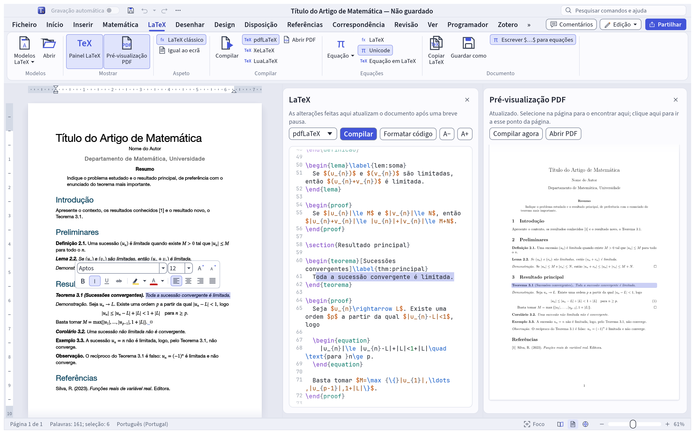
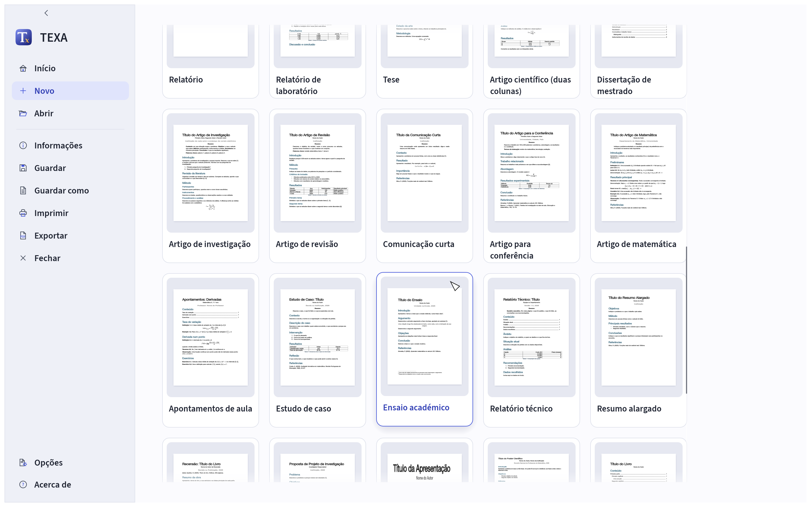
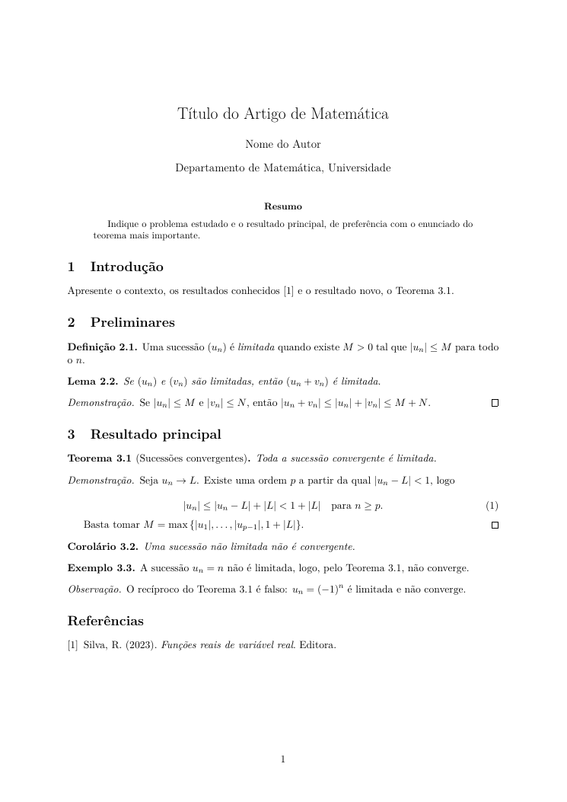

# TEXA

**O processador de texto que fala LaTeX.** Escreve como no Word e obtém LaTeX limpo. Ou abre um
`.tex` e edita-o como um documento normal. Funciona em macOS (Apple silicon) e Windows.



[⬇ Descarregar a versão mais recente](https://github.com/alextrocado/texa-releases/releases/latest)

- **macOS:** abre o `.dmg` e arrasta o TEXA para Aplicações.
- **Windows:** corre o `setup.exe`.

Depois de instalado, o TEXA procura versões novas quando o abres e pergunta se queres atualizar.

---

## Exemplos de utilização

### 1. Do Word para LaTeX

1. Abre um `.docx` (Ficheiro › Abrir, ou arrasta-o para a janela).
2. No separador **LaTeX**, carrega em **Painel LaTeX**: o código LaTeX do documento aparece ao lado
   da página.
3. Carrega em **Compilar**: o PDF abre feito pelo LaTeX.
4. **Guardar como** › `.tex` grava o ficheiro LaTeX (as imagens ficam ao lado, `nome-1.png`…).

Os títulos passam a `\section`, as listas a `itemize`/`enumerate`, as tabelas a `tabular`, as notas
a `\footnote`, as citações a `\cite` com `thebibliography`, as legendas a `\caption` com `\label`
e `\ref`.

### 2. Do LaTeX para Word

1. Abre um `.tex`: o TEXA mostra-o como um documento normal, com as equações desenhadas.
2. Edita o texto, as tabelas e as equações como no Word.
3. Grava em `.tex` outra vez, ou em `.docx` para enviar a quem usa Word.

Por exemplo, este ficheiro:

```latex
\documentclass[12pt,a4paper]{article}
\usepackage[portuguese]{babel}
\title{Funções reais}
\author{Prof. Silva}
\begin{document}
\maketitle
\section{Domínio}
O domínio de $f(x)=\sqrt{x-2}$ é $[2,+\infty[$.
\begin{equation}
  f'(x)=\frac{1}{2\sqrt{x-2}}
\end{equation}
\end{document}
```

abre com o título, a secção e as duas equações editáveis. Gravado outra vez em LaTeX, mantém a
classe, as opções, `\maketitle` e a equação numerada.

### 3. O PDF ao lado da página

No separador **LaTeX**, carrega em **Pré-visualização PDF**: o documento compilado aparece ao lado
da página e atualiza-se sozinho pouco depois de cada alteração. Continuas a escrever na página,
como no Word.

- O texto que selecionas na página (ou no Painel LaTeX) fica destacado no PDF.
- Um clique no PDF leva o cursor a esse sítio da página.
- **Cmd+T** (Ctrl+T no Windows) compila quando quiseres.

### 4. Equações com o teclado (atalhos do MathType)

| Teclas (macOS) | Faz |
|---|---|
| Cmd+E | Nova equação |
| Cmd+Shift+E | Equação no meio do texto |
| Cmd+T | Compilar o LaTeX |
| Ctrl+F | Fração |
| Ctrl+H / Ctrl+L | Expoente / índice |
| Ctrl+R | Raiz quadrada |
| Ctrl+G, depois p | π (Ctrl+G e uma letra: letra grega) |
| Ctrl+D, depois R | ℝ |
| Ctrl+I | Integral |
| Tab | Casa seguinte do modelo |

No Windows, Cmd é Ctrl. Todos os atalhos estão em **Inserir › Atalhos de Equações** e podem ser
mudados: clica com o botão direito num símbolo da Paleta de Equações › **Definir Atalho…**.

Também podes escrever `$x^2+1$` no texto: com a opção **Escrever $…$ para equações** ligada (separador
LaTeX), passa a uma equação.

### 5. 32 modelos LaTeX prontos

Em **Ficheiro › Novo**, os modelos aparecem em duas secções, **Documentos Word** e **Documentos
LaTeX** (também em **LaTeX › Modelos LaTeX**). Todos em português:

- **Avaliação:** teste (classe `exam`), teste ao estilo do exame nacional, escolha múltipla, mini-teste;
- **Fichas e aulas:** ficha de trabalho, ficha com resoluções, ficha (classe `exam`), formulário,
  plano de aula, apontamentos de aula;
- **Artigos:** artigo, artigo de investigação, artigo de revisão, artigo de matemática (teoremas e
  demonstrações), artigo científico em duas colunas, artigo para conferência, comunicação curta,
  resumo alargado, ensaio académico, estudo de caso, recensão crítica;
- **Trabalhos longos:** relatório, relatório técnico, relatório de laboratório, tese, dissertação de
  mestrado, livro, proposta de projeto de investigação;
- **Apresentar:** apresentação Beamer, poster científico;
- **Outros:** carta formal, currículo.

Escolhe um, escreve por cima e compila.



### 6. Teoremas e demonstrações

Os teoremas, definições, lemas, corolários e demonstrações do `amsthm` abrem como parágrafos
próprios («Teorema 1.2 (Pitágoras).», «Demonstração. … □») e voltam a ser
`\begin{teorema}…\end{teorema}`, com a numeração por secção e as referências `\ref`.



### 7. O aspeto do PDF

No separador **LaTeX**, em **Aspeto**:

- **LaTeX clássico** (por omissão): o PDF tem o aspeto de um documento feito à mão em LaTeX, com a
  letra Computer Modern, secções numeradas e `\maketitle`;
- **Igual ao ecrã**: o PDF imita a página do documento (letra, margens, cores e espaçamentos).

### 8. PDF para documento editável

Arrasta um PDF para a janela: o texto, os títulos e as imagens passam a um documento que podes
editar e gravar em `.docx` ou `.tex`.

---

## Para compilar LaTeX

O TEXA escreve e lê LaTeX sem nada instalado. Para **Compilar** (fazer o PDF) é preciso uma
distribuição de TeX:

- **macOS:** [MacTeX](https://www.tug.org/mactex/)
- **Windows:** [MiKTeX](https://miktex.org/) ou [TeX Live](https://www.tug.org/texlive/)

Se não estiver instalada, o TEXA diz-te isso e mostra a ligação para a descarregares.

## Línguas

A interface está em 20 línguas, entre elas português, inglês, espanhol, francês e alemão. Muda-se
em Ficheiro › Opções.

---

© 2026 Alexandre Trocado · mail@alexandretrocado.com
